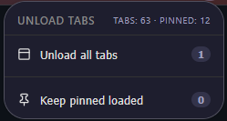

# Unload-tabs

A lightweight Firefox extension to unload tabs and free up memory — without closing them.

<div align="center">
  
</div>

## What it does

Unloading a tab removes it from memory but keeps it in your tab bar. Click the tab later and it reloads instantly. Perfect for when you have dozens of tabs open but only need a few.

## Features

- **Unload all tabs** — frees memory from every tab except the one you're on
- **Keep pinned loaded** — unloads everything except pinned tabs
- **Live badge** — shows the percentage of tabs currently unloaded
- **Live tab counts** - show tabs count, and pinned tabs count
- **Smart skipping** — ignores internal pages (`about:`, `chrome://`) that can't be unloaded anyway

## Install


### From file
1. Download the latest `.xpi` from [Releases](../../releases)
2. In Firefox: `about:addons` → gear ⚙️ → **Install Add-on From File**
3. Pick the `.xpi`

### From source (development)

Install web-ext:

```bash
npm install --global web-ext
```

Clone this repo, then run:

```bash
web-ext run
```

## Usage

1. Click the toolbar icon
2. Pick **Unload all tabs** or **Keep pinned loaded**
3. Watch the badge show your unloaded %

## Check memory freed

Firefox doesn't always gray out unloaded tabs — so verify by memory instead:

1. Open a new tab and go to `about:processes` (Firefox's built-in Task Manager)
2. Note the tab's memory usage before unloading
3. Run Tab Unloader
4. The unloaded tab **disappears from `about:processes`** — that means its memory was freed
5. Watch the total at the bottom drop

Tip: `about:processes` also shows every tab's live memory, useful for finding heavy tabs.

## Notes

- The current tab is **never** unloaded.
- Some pages (`about:config`, `about:addons`, etc.) can't be unloaded — Firefox blocks it.
- Unloaded tabs may not always gray out visually. This is a Firefox limitation, not a bug. Memory **is** freed.

## License

MIT